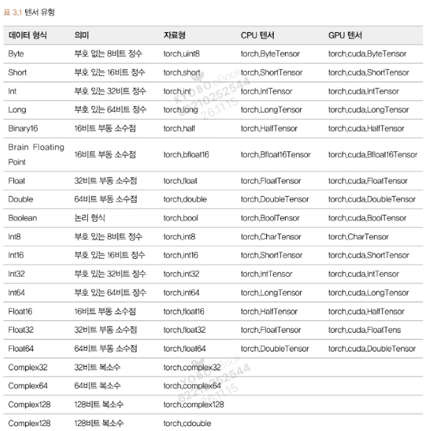
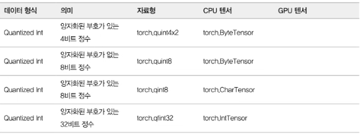

# 3.1. 텐서
- 텐서: GPU 가속을 적용받을 수 있는 배열과 유사한 자료형
- 종류
    - 스칼라, 벡터, 행렬, ...
    - 각각 0차원, 1차원, 2차원 배열임. 3차원 이상부턴 n차원 배열

## 텐서 생성
- torch.Tensor(): 텐서의 기본형으로 텐서 인스턴스 생성
- torch.tensor()은 자동으로 자료형 할당
    - 의도하지 않은 자료형으로 바뀔 수 있으니 주의

```py
# 파이토치 임포트
import torch

# 커널 충돌을 막기 위한 설정
import os
os.environ['KMP_DUPLICATE_LIB_OK'] = 'True'


print(torch.tensor([1, 2, 3]))
print(torch.Tensor([
    [1, 2, 3],[4, 5, 6]
]))
print(torch.LongTensor([1, 2, 3]))
print(torch.FloatTensor([1, 2, 3]))
```
```
tensor([1, 2, 3])
tensor([[1., 2., 3.],
        [4., 5., 6.]])
tensor([1, 2, 3])
tensor([1., 2., 3.])
```

## 텐서 속성
- shape: 크기
- dtype: 자료형 
- device: 장치
    - gpu를 쓰냐 cpu를 쓰냐

```py
import torch

tensor = torch.rand(1, 2) # 1행 2열의 랜덤 텐서
print(tensor)
print(tensor.shape)
print(tensor.dtype)
print(tensor.device)
```

```
tensor([[0.5911, 0.7196]])
torch.Size([1, 2])
torch.float32
cpu
```

## 차원 변환
- reshape(): 넘파이 reshape 메서드와 동일
```py
import torch

tensor = torch.rand(1, 2)
print(tensor, tensor.shape)

# 차원 변환 수행
tensor = tensor.reshape(2, 1)
print(tensor, tensor.shape)
```
```
tensor([[0.2773, 0.7094]]) torch.Size([1, 2])
tensor([[0.2773],
        [0.7094]]) torch.Size([2, 1])
```

## 자료형 설정
- 텐서의 자료형 설정에 입력되는 인수는 torch.* 형태로 할당
```py
import torch

tensor = torch.rand((3, 3), dtype=torch.float)
print(tensor)
```
```
tensor([[0.4265, 0.6776, 0.3367],
        [0.2587, 0.5129, 0.8251],
        [0.4823, 0.7872, 0.8528]])
```

## 장치 설정
- 장치 설정을 제대로 하지 않으면 오류 발생
```py
import torch

device = 'cuda' if torch.cuda.is_available() else 'cpu'

cpu = torch.FloatTensor([1, 2, 3]) # cpu 장치 사용하는 변수 
gpu = torch.cuda.FloatTensor([1, 2, 3]) # gpu 장치 사용하는 변수
tensor = torch.rand((1, 1), device=device) # device 변수에 따라 장치 결정됨

print(device)
print(cpu, gpu, tensor)
```
```
C:\Users\sdh05\AppData\Local\Temp\ipykernel_19832\3024951257.py:6: UserWarning: The torch.cuda.*DtypeTensor constructors are no longer recommended. It's best to use methods such as torch.tensor(data, dtype=*, device='cuda') to create tensors. (Triggered internally at C:\actions-runner\_work\pytorch\pytorch\torch\csrc\tensor\python_tensor.cpp:80.)
  gpu = torch.cuda.FloatTensor([1, 2, 3]) # gpu 장치 사용하는 변수
cuda
tensor([1., 2., 3.]) tensor([1., 2., 3.], device='cuda:0') tensor([[0.1860]], device='cuda:0')
```

## 장치 변환
- 같은 장치를 사용하는 텐서끼리만 연산 가능
    - cpu와 gpu간 연산 불가능!

```py
import torch

cpu = torch.FloatTensor([1, 2, 3])
gpu = cpu.cuda() # 변수 cpu를 cuda를 사용하도록 변환

gpu2cpu = gpu.cpu() # 변수 gpu를 cpu를 쓰도록 변환
cpu2gpu = cpu.to('cuda')

print(cpu)
print(gpu)
print(gpu2cpu)
print(cpu2gpu)
```
```
tensor([1., 2., 3.])
tensor([1., 2., 3.], device='cuda:0')
tensor([1., 2., 3.])
tensor([1., 2., 3.], device='cuda:0')
```

## 넘파이 배열의 텐서 변환
```py
import torch
import numpy as np

ndarray = np.array([1, 2, 3], dtype=np.uint8)
print(torch.tensor(ndarray)) # array -> tensor
print(torch.Tensor(ndarray)) # 자료형 자동 설정
print(torch.from_numpy(ndarray))
```
```
tensor([1, 2, 3], dtype=torch.uint8)
tensor([1., 2., 3.])
tensor([1, 2, 3], dtype=torch.uint8)
```

## 텐서의 넘파이 배열 변환
- 역전파 과정에서 넘파이 배열이 사용됨
- detach(): 현재 그래프에서 분리된 새로운 텐서 반환

```py
import torch

tensor = torch.cuda.FloatTensor([1, 2, 3])

ndarray = tensor.detach().cpu().numpy()
print(ndarray, type(ndarray))
```
```
[1. 2. 3.] <class 'numpy.ndarray'>
```
- 텐서 유형 표



